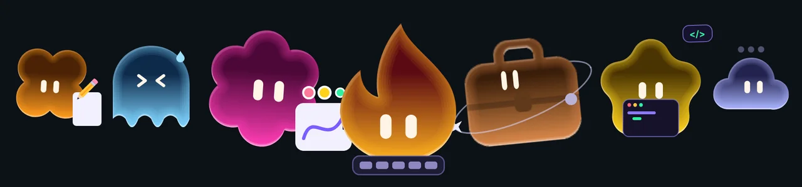

# Никита Егоров — продуктовый дизайнер

Я продуктовый дизайнер с опытом 5+ лет. Работал с B2C-продуктами на 10+ млн пользователей, сложными B2B-интерфейсами и AI-инструментами. Веду задачи полным циклом, от исследований до контроля реализации.

[Портфолио](https://nikitaegorov.framer.ai) · [Telegram](https://t.me/egorov_d_nikita) · [LinkedIn](https://linkedin.com/in/egorovdnikita) · Москва

---

## Работы

### [Agent Pulse](https://github.com/egorovdnikita/agent-pulse) · MacOS-приложение · Open Source

Живой характер ноутбука для macOS: маскот поверх всех окон показывает, как себя чувствует Mac и что делают ИИ-агенты. Главное — не пропустить момент, когда агент ждёт тебя: маскот смотрит прямо на тебя и подпрыгивает.

- **Агенты.** Claude Code, Codex, агенты в Orca, Claude Cowork, Claude на claude.ai, Figma Make и Figma AI. Маскот показывает, что агент думает, работает, ждёт тебя, закончил или получил ошибку. Если агентов несколько, в меню есть список, а маскот показывает самого важного.
- **Тело ноутбука.** Реагирует на батарею и кабель зарядки, перегрев, память, диск, сеть, флешки и iPhone, мониторы, сон, звук и наушники. Только системные сигналы — без чтения окон, файлов, буфера и названий приложений.
- **Характер.** Говорит короткими репликами в облачке, иногда шутит. Следит за курсором, его можно гладить, тыкать, перетаскивать и бросать.
- **Тишина.** Созвон, полный экран, тихие часы — реакции только глазами. Пока маскота не видно, «ждёт тебя» и «готово» приходят системным уведомлением.

Замер на MacBook M2: процессор 0.7–2.6%, память 31–44 MB. Стек: Swift · SwiftUI · AppKit · Lottie.
